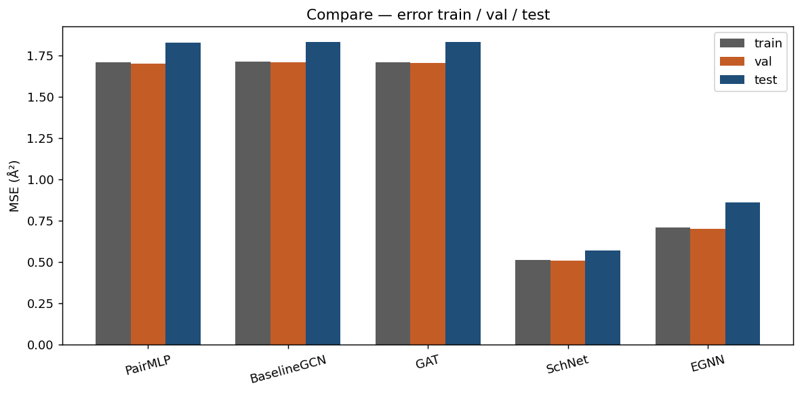
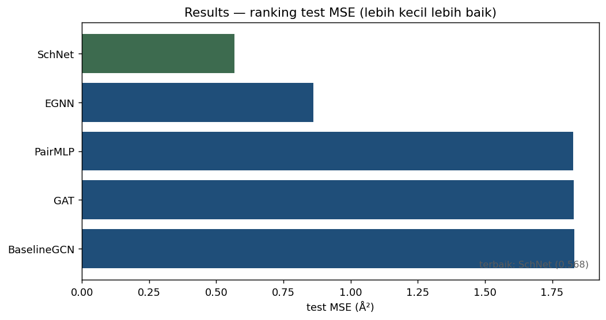

# RCSB PDB → Graph → E(3)-GNN (PyTorch vs JAX)

Pipeline riset: struktur protein RCSB (mmCIF) diubah jadi **graf residu Cα**, lalu beberapa GNN geometrik dilatih untuk memprediksi **jarak pasangan Cα pada edge graf**.

> Repo GitHub memuat **10 PDB sampel** + chart eksperimen + gallery. Full set lokal (~5000 struktur) tidak di-commit; unduh ulang lewat script bila perlu.

---

## Tujuan penelitian

Membandingkan model graf geometrik — **PairMLP**, **BaselineGCN**, **GAT**, **SchNet**, **EGNN** (PyTorch), serta **EGNN JAX/Flax** — pada tugas regresi jarak edge Cα dari struktur X-ray protein-only (resolusi ≤ 2.5 Å).

Tujuan praktisnya: mengecek forward/backward GPU, kekayaan representasi geometri (invarian jarak vs equivariant koordinat), dan perbedaan implementasi PyTorch vs JAX — **bukan** model fungsi biologi terpublikasi.

---

## Eksperimen singkat

1. Unduh mmCIF dari RCSB → `raw/`
2. Preprocess koordinat all-atom & Cα → `processed/structures/`
3. Bangun graf residu: edge **sequential** (\(i\leftrightarrow i+1\)) + **radius 8 Å** → `processed/graphs/`
4. Train 20 epoch (compare) / grid singkat (tune) → metrik di `results/metrics/`
5. Visualisasi: cartoon, scatter, backbone, graf + chart EDA/training/compare

**Split full run:** ~80/10/10 train/val/test (~4005 / 501 / 501 dari ~5007 protein).

**Sampel di repo:** lihat [`metadata/sample_ids.txt`](metadata/sample_ids.txt)  
(`10AF`, `10CW`, `10CX`, `10DC`, `10DT`, `10EE`, `10EF`, `10FS`, `10FV`, `10GA`).

Jelajah hasil visual:

- Hub chart: [`results/plots/hub.html`](results/plots/hub.html)
- Gallery 10 protein (4 panel): [`results/plots/gallery.html`](results/plots/gallery.html)

---

## Rumus & formula singkat

**Jarak Euclidean** antar Cα (label & radius edge):

\[
d_{ij}=\|x_i-x_j\|_2=\sqrt{\sum_k(x_{ik}-x_{jk})^2}
\]

**Loss** (MSE pada edge):

\[
\mathcal{L}=\frac{1}{|E|}\sum_{(i,j)\in E}(\hat{d}_{ij}-d_{ij})^2
\]

**Head prediksi** (semua model): \(\hat{d}_{ij}=\mathrm{MLP}([h_i\|h_j])\).

**GAT** — perhatian + softmax per tetangga:

\[
\alpha_{ij}=\frac{\exp(e_{ij})}{\sum_{k\in\mathcal{N}(i)}\exp(e_{ik})}
\]

**SchNet** — Gaussian RBF jarak:

\[
\phi_k(d)=\exp\!\big(-\gamma(d-\mu_k)^2\big),\quad \gamma=(n_{\mathrm{rbf}}/\mathrm{cutoff})^2
\]

**EGNN** — pesan dari jarak kuadrat; update koordinat equivariant:

\[
m_{ij}=\phi_e(h_i,h_j,\|x_i-x_j\|^2),\quad
x_i\leftarrow x_i+\mathrm{mean}_j\big[(x_i-x_j)\,\phi_x(m_{ij})\big]
\]

Prediksi jarak diharapkan **SE(3)-invariant**; koordinat EGNN **equivariant** (dicek di `src/geometry/se3.py`).

---

## Hasil singkat

Dari full local run (~5007 protein, 20 epoch compare):

| Model (PyTorch) | Test MSE |
|-----------------|----------|
| PairMLP | ~1.83 |
| BaselineGCN | ~1.83 |
| GAT | ~1.83 |
| **SchNet** | **~0.57** (terbaik compare) |
| EGNN | ~0.86 |

Benchmark EGNN framework (run terpisah): **JAX ~0.50** vs **PyTorch ~0.85** test MSE (init/training path berbeda; angka tidak untuk klaim biologi).

Tune EGNN singkat (8 epoch): val terbaik `hidden=64`, `layers=3` (val ~1.01; test ~1.35 pada grid pendek).





Ringkasan JSON: [`phase10_compare.json`](results/metrics/phase10_compare.json), [`phase10_benchmark.json`](results/metrics/phase10_benchmark.json), [`phase11_tune.json`](results/metrics/phase11_tune.json).

---

## Hardware (mesin pengembangan)

- Windows, NVIDIA GeForce RTX 5060 Laptop GPU (Blackwell, sm_120)
- Python 3.14
- PyTorch CUDA 12.8 nightly
- JAX GPU via `winjax` (native Windows CUDA 13 PJRT). Official `jax[cuda13]` is Linux-only.
- Flax `0.12.9` installed with `--no-deps` to keep winjax's `jax==0.11.0` pin.

PyTorch and JAX **must run in separate processes** on Windows (different cuDNN families).

## Run

Interactive walkthrough:

```bash
jupyter notebook notebooks/pipeline.ipynb
```

CLI:

```bash
python scripts/check_environment.py
python scripts/download_rcsb.py configs/egnn.yaml
python scripts/preprocess.py
python scripts/build_graph.py configs/egnn.yaml
python scripts/visualize.py configs/egnn.yaml
python scripts/compare_models.py configs/egnn.yaml
python scripts/train_jax.py configs/egnn.yaml
python scripts/tune_egnn.py configs/egnn.yaml
python scripts/benchmark_cuda.py --from-metrics
python scripts/plot_experiment.py --force
```

Chart eksperimen ditulis ke `results/plots/experiment/` dan dibuka lewat [`results/plots/hub.html`](results/plots/hub.html). Gallery protein: [`results/plots/gallery.html`](results/plots/gallery.html).

Existing mmCIF files in `raw/` are kept and counted toward `n_structures`.
`configs/egnn.yaml` uses `val_fraction: 0.1` and `test_fraction: 0.1`.

`benchmark_cuda.py` does not import either framework. It subprocesses the E(3)
checks and both EGNN trainers. Pass `--from-metrics` to rebuild the JSON
without retraining.

## Diagnostic task

Predict **C-alpha pairwise distances on graph edges**. Labels come from 3D
coordinates. Engineering check (forward/backward/GPU), not a biological function
model.

- Phase 7: `BaselineGCN` — residue type + graph topology (no coordinates in the net)
- Phase 8: `EGNN` — SE(3) messages from `||x_i - x_j||^2`; coordinates update equivariantly
- Phase 9: EGNN on the 1000-entry set (archived metrics)
- Phase 10: PairMLP, BaselineGCN, GAT, SchNet, EGNN on the ~5000-entry set
- Phase 11: EGNN hyperparameter grid (hidden × layers)

## Representations

- All-atom: every unique atom name per residue, `coords.shape = (N_atom, 3)`
- C-alpha: one `CA` per residue, `coords.shape = (N_res, 3)` (~8× fewer nodes)

Graphs are residue/C-alpha. Sequential edges stay inside a chain; radius cutoff is set in config.

`scripts/visualize.py` writes matplotlib plots and PyMOL cartoons. Open the four-panel gallery for the published sample IDs.

```text
pymol raw/10AF.cif.gz
```
